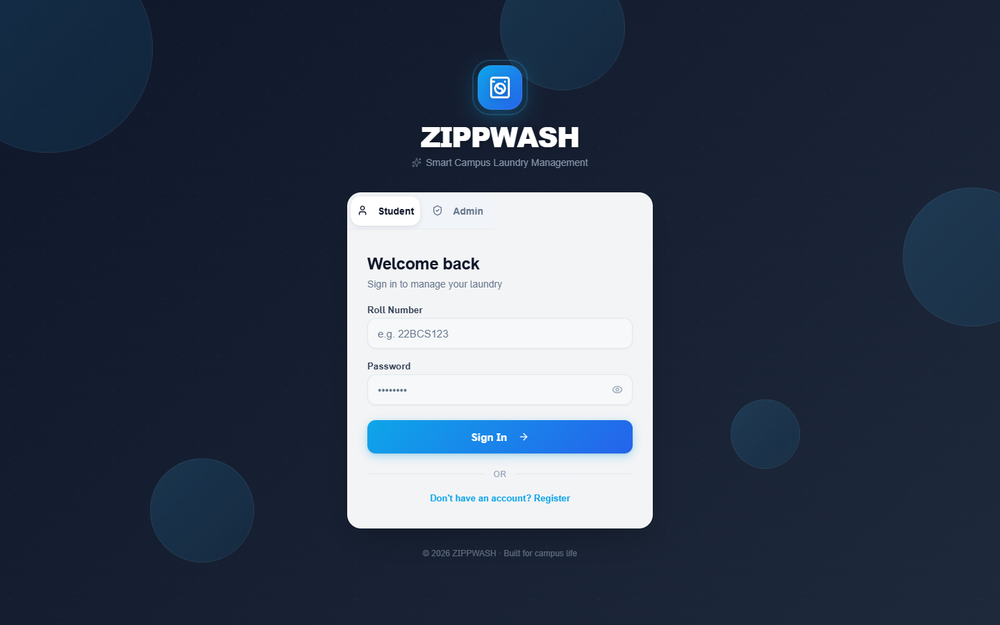
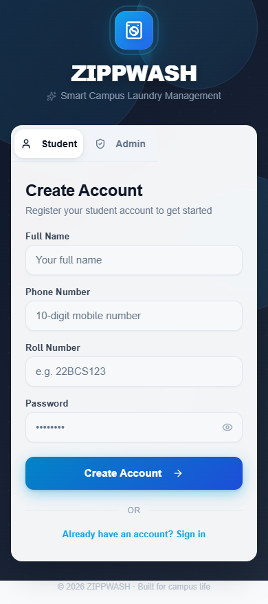
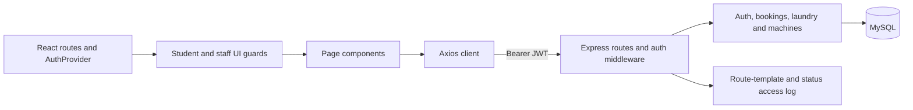

# ZippWash

A campus laundry-management prototype with a React/TypeScript frontend and an Express/MySQL API. Students and staff have separate navigation and sign-in flows. Booking, laundry status, machine inventory and transaction endpoints are implemented; a working production payment integration is not established.

## Actual application screens





Captured in Microsoft Edge from the built application at 1440 × 900 and 390 × 844. The browser used empty local storage and blocked external requests. No account was created, no backend responses were fabricated, and no database or payment transaction was performed. These captures verify the public forms, not authenticated workflows.

## Implementation



- `src/App.tsx` defines the live routes and lazy page imports. Student pages include the dashboard, tracking, pricing, rewards, transactions and reminders. Staff pages include orders, customers, inventory and settings.
- `src/services/api.ts` attaches the locally stored JWT to API requests. Browser route guards are a navigation convenience; API authorization must enforce access separately.
- `backend/src/routes/` registers authentication, student, staff, machine, slot and feedback endpoints. Staff routes require the staff role.
- `backend/src/middleware/requestLogger.js` writes timestamp, method, matched route template and status after a response completes. It excludes raw URLs, request bodies and response payloads; write failures produce a generic diagnostic.
- `src/sections/` and `zippwash-final-project/` contain older implementations. They are preserved and should not be confused with the live route table.

## Run the frontend

Use Node.js compatible with Vite 7 (20.19+ or 22.12+) and npm. The audit used Node 24 on Windows.

```sh
npm ci --ignore-scripts
cp .env.example .env
npm run dev
```

On PowerShell, replace the copy command with `Copy-Item .env.example .env`. Open the local URL printed by Vite. Unauthenticated visitors are redirected to `/login`. `VITE_API_URL` defaults to `http://localhost:5000/api` and is compiled into the frontend; rebuild after changing a production API URL. Frontend environment variables are public browser configuration.

```sh
npm run build
npm run preview
```

The build runs TypeScript and Vite and writes `dist/`. A deployed SPA needs fallback routing to `index.html` for application paths.

## Configure the API

```sh
cd backend
npm ci --ignore-scripts
cp .env.example .env
```

Set `DB_HOST`, `DB_USER`, `DB_PASSWORD`, `DB_NAME`, a fresh random `JWT_SECRET`, and optionally `PORT` and `FRONTEND_URL`. Use a dedicated development database and a restricted database user. The backend depends on bcrypt; after reviewing dependency lifecycle scripts, ensure its native binding is available on your platform. Backend installation and a running MySQL service were not verified in this audit.

Review `backend/schema.sql` before applying it to an empty database you control. It names the `zippwash` database explicitly. Compare its tables with the controllers before testing an end-to-end workflow. `migration.sql` targets an existing schema and has database-version-sensitive statements; it is not a verified universal migration path.

`setup_db.js` does **not** create the full schema: it modifies the staff table and seeds predictable demonstration accounts. Its staff username seed also differs from the email-based login query. `init_db.js` creates an older, smaller schema. Do not use either as an automatic production initializer. Provision a staff account with a correctly hashed password and email in your own test database.

Once dependencies, schema and environment are configured:

```sh
npm run dev
# or: npm start
```

The API defaults to port 5000. CORS permits specific local development origins and the configured `FRONTEND_URL`; the exact list is in `backend/src/index.js`. No deployed endpoint is asserted.

## Verification

From the repository root:

```sh
node --test backend/test/requestLogger.test.js
npm run build
npm run lint
```

On 9 November 2026, both logging regressions passed. They verify exclusion of synthetic path/query/body/response markers and nonfatal log-write failure. The frontend production build passed during this repair (2,838 modules). Real browser checks verified unauthenticated redirect, registration-form switching, no document overflow at the captured widths, and no uncaught page errors.

ESLint still reports 13 existing errors, including component/export patterns and render-time purity/state findings. The logger tests do not verify MySQL, JWT authentication, payments or booking concurrency. No automated full application test suite or CI workflow is established by this change.

## Known limits

- Booking uses a separate availability query and insert; concurrent requests can race. Transactional enforcement and an appropriate database constraint require a tested schema change.
- Student-specific slot handlers authenticate tokens but do not consistently enforce a student role. Review role and resource ownership across every endpoint before deployment.
- Some controller failures return database error details, and controller diagnostics can include exception data. The metadata-only access logger does not fix every logging/error disclosure path.
- JWTs are stored in `localStorage`, so injected scripts could access them. Session storage, expiry/revocation and browser security need a separate deployment review.
- Pricing, rewards, administrative summaries and older page trees include demonstration or estimated values. A displayed payment UI is not proof of a payment gateway integration.
- Database initialization, full account lifecycle, device integration, accessibility compliance and authenticated end-to-end behavior remain unverified. This is a prototype, not a production-readiness claim.
- Tracked backend dependency files remain in the repository. They were preserved; future dependency cleanup should be reviewed separately.

No root license file is provided. The backend package's ISC metadata alone does not establish a license for the complete repository.

## Repair and rollback

This repair replaces payload logging with metadata-only access logging, adds two offline regressions, corrects setup and capability claims, and adds real public-form screenshots. Revert the repair commit through normal Git history to undo it; no history rewrite or database migration is required.
